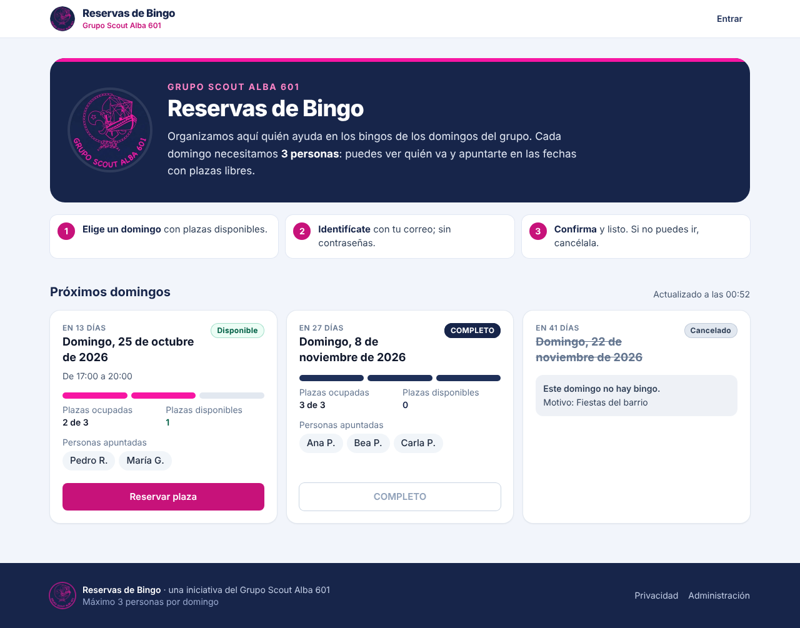

# Reservas de Bingo · Grupo Scout Alba 601

Web del **Grupo Scout Alba 601** para organizar quién ayuda en los domingos de bingo: **3 plazas por domingo**, nombres visibles para todos, reservas y cancelaciones desde el móvil y panel de administración. Pensada para publicarse en **https://reservas.pedroriquelme.tech**.



## Verla ya en tu ordenador (modo demostración)

> Abrir `index.html` con doble clic muestra una página en blanco: ese archivo es la entrada para la herramienta de compilación, no la web terminada. La web necesita un servidor y una base de datos.

Sin Supabase ni cuentas, con datos de ejemplo. Solo necesitas [Node.js](https://nodejs.org) 20.19 o superior (`node -v`):

```bash
cd ~/Downloads/reservas-bingo
npm ci          # la primera vez (1-2 minutos)
npm run demo
```

Abre <http://localhost:5173>. Para entrar, usa cualquier correo inventado (`tu@demo.local`): **el código aparece en la terminal**, no se envía ningún correo. Para el panel, entra con `admin@demo.local` y pulsa «Administración» al pie. La base de datos es un PostgreSQL real en memoria (PGlite) con las migraciones de producción; los datos se borran al cerrar con `Ctrl+C`. La demo no tiene tiempo real (se refresca cada 30 s).

## Qué hace

- Lista de próximos domingos con plazas ocupadas/libres, quién va («Pedro R.») y estado **Disponible / COMPLETO / Cancelado**.
- Reserva en tres pasos: código por correo (sin contraseñas) → nombre y apellidos la primera vez → resumen → confirmación.
- El límite de 3 plazas lo garantiza la **base de datos**, también con muchas personas reservando a la vez.
- «Mis reservas»: ver, cancelar con confirmación, editar datos y eliminar la cuenta.
- Tiempo real: lo que reserva una persona aparece en los demás dispositivos sin recargar.
- Panel privado: fechas (manuales, generadas cada 14 días con vista previa, editar, cancelar avisando de las reservas afectadas, reabrir), reservas (cancelar, mover, apuntar a alguien sin cuenta, exportar CSV), participantes y permisos, historial y estadísticas, generación automática configurable.
- Identidad del grupo: logo del Grupo Scout Alba 601 y sus colores, azul marino y fucsia (también en el correo de acceso).
- Diseño responsive (móvil, tablet y ordenador), accesible con teclado y lector de pantalla.

## Tecnología

React 19 + TypeScript + Tailwind CSS 4 (Vite) · Supabase (PostgreSQL, Auth, RLS, Realtime) · Resend (correo) · Vercel (alojamiento y HTTPS) · Vitest + Playwright (pruebas). Coste: **0 €/mes** con los planes gratuitos (detalles y límites en [docs/01-arquitectura.md](docs/01-arquitectura.md)).

## Documentación (en orden)

| | |
|---|---|
| [01 · Arquitectura y costes](docs/01-arquitectura.md) | Servicios elegidos, por qué y cuánto cuestan |
| [02 · Base de datos](docs/02-base-de-datos.md) | Tablas, relaciones, garantías, funciones y RLS |
| [03 · Crear y configurar el proyecto](docs/03-puesta-en-marcha.md) | Supabase, correo, primer admin, ejecución local |
| [04 · Despliegue, subdominio y HTTPS](docs/04-despliegue-dominio-https.md) | GitHub, Vercel, DNS en Dondominio, certificado, comprobación |
| [05 · Pruebas y resultados](docs/05-pruebas.md) | Las 15 pruebas obligatorias y cómo verificarlas en producción |
| [06 · Seguridad y protección de datos](docs/06-seguridad-y-privacidad.md) | Medidas aplicadas y RGPD básico |
| [07 · Mantenimiento](docs/07-mantenimiento.md) | Rutina, copias, pausas de Supabase, problemas frecuentes |

## Comandos

```bash
npm ci                 # instalar dependencias
npm run demo           # demostración local sin Supabase (datos de ejemplo)
npm run dev            # desarrollo contra tu Supabase (necesita .env.local)
npm run build          # comprobar tipos y compilar para producción
npm test               # pruebas unitarias
npm run test:db        # pruebas de base de datos (necesita DATABASE_URL_ADMIN)
npm run test:e2e       # pruebas en navegador (necesita DATABASE_URL_ADMIN)
npm run comprobar      # comprobar el despliegue real (DNS, HTTPS, rutas, seguridad)
```

## Estructura

```
reservas-bingo/
├── supabase/
│   ├── migrations/            ← esquema, funciones y seguridad (ejecutar en orden)
│   ├── opcional/              ← generación automática diaria (pg_cron)
│   ├── plantillas-email/      ← correo del código de acceso
│   ├── admin_inicial.sql      ← nombrar al primer administrador
│   └── mantenimiento.sql      ← comprobaciones y limpieza periódica
├── src/
│   ├── lib/                   ← cliente Supabase, API, fechas, validación, errores, tiempo real
│   ├── auth/                  ← sesión (código/enlace por correo)
│   ├── components/            ← tarjetas, diálogo de reserva, acceso, UI común
│   ├── paginas/               ← inicio, mis reservas, acceso, privacidad…
│   └── admin/                 ← panel de administración (se carga aparte)
├── tests/
│   ├── unit/                  ← Vitest
│   ├── db/                    ← Vitest + PostgreSQL real (RLS, permisos, concurrencia)
│   └── e2e/                   ← Playwright contra el simulador local
├── demo/iniciar.mjs           ← modo demostración (npm run demo)
├── herramientas/simulador/    ← API local compatible con supabase-js (demo y pruebas)
├── scripts/comprobar-produccion.mjs
├── .github/workflows/         ← pruebas en cada push · mantener Supabase activo
├── vercel.json                ← rutas SPA y cabeceras de seguridad
└── .env.example
```
