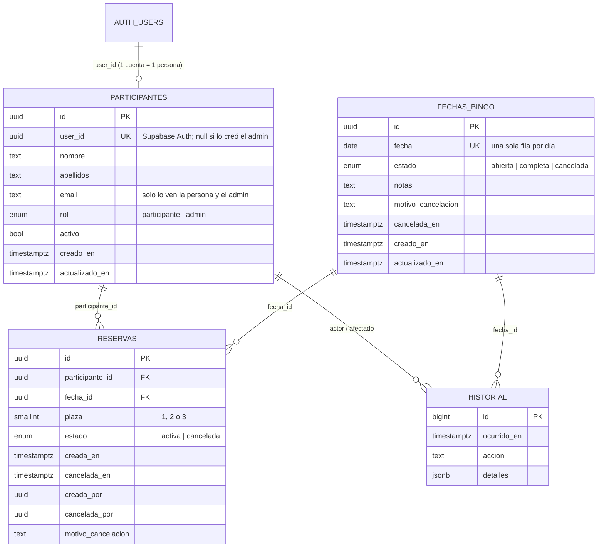

# Fase 2 · Base de datos

Archivos (ejecutar en este orden):

| Archivo | Contenido |
|---|---|
| `supabase/migrations/20261011000100_esquema.sql` | Tipos, tablas, restricciones, índices y triggers |
| `supabase/migrations/20261011000200_funciones.sql` | Todas las operaciones (reservar, cancelar, administración…) |
| `supabase/migrations/20261011000300_seguridad.sql` | RLS, permisos y tiempo real |
| `supabase/opcional/generacion_automatica_diaria.sql` | Tarea diaria con pg_cron (opcional) |

## Modelo

Además, `configuracion` (una sola fila) guarda los ajustes de la generación automática.

## Cómo se garantizan las reglas obligatorias

| Regla | Mecanismo en la base de datos |
|---|---|
| **Nunca más de 3 reservas activas por fecha** | Columna `plaza` con `check (plaza between 1 and 3)` + índice único parcial `(fecha_id, plaza) where estado = 'activa'`. Con solo 3 valores posibles y sin repetir, **es físicamente imposible** guardar una 4.ª reserva activa, venga de donde venga (web, panel de Supabase, un error futuro en el código). |
| **Sin carreras entre solicitudes simultáneas** | `reservar` bloquea la fila de la fecha con `SELECT … FOR UPDATE` antes de contar. Las solicitudes del mismo domingo se ponen en fila: la segunda espera a que la primera termine y ve su resultado. Así nadie recibe «completo» habiendo plaza, ni dos personas se llevan la misma. |
| **Una persona no reserva dos veces el mismo domingo** | Índice único parcial `(participante_id, fecha_id) where estado = 'activa'`. Tras cancelar, puede volver a apuntarse. |
| **Plazas calculadas, no editables** | No existe ningún contador. Las plazas se cuentan siempre a partir de las reservas activas, y nadie puede escribir en las tablas desde el navegador. |
| **Sin fechas duplicadas** | `unique (fecha)` en `fechas_bingo`. Generar fechas usa `on conflict do nothing` y devuelve cuáles se omitieron. |
| **Estado abierta / completa coherente** | Trigger en `reservas` que recalcula el estado de su fecha después de cada cambio. |
| **Persistencia y acceso desde cualquier dispositivo** | Todo vive en PostgreSQL; el navegador solo guarda la sesión de inicio. |

## Funciones (la «API»)

**Visitantes (sin sesión)**

| Función | Qué hace |
|---|---|
| `calendario_publico()` | Próximas fechas con plazas, estado y nombres públicos («Pedro R.»). Con sesión, indica también si ya tienes plaza. |

**Participantes (con sesión)**

| Función | Qué hace |
|---|---|
| `mi_perfil()` / `guardar_mi_perfil(nombre, apellidos)` | Ver / crear o editar tus datos (validados y normalizados). |
| `reservar(fecha)` | Reserva atómica (ver arriba). |
| `cancelar_mi_reserva(reserva)` | Solo la tuya; con otra persona responde «no encontrada». |
| `mis_reservas()` | Tus reservas activas e historial. |
| `eliminar_mi_cuenta()` | Derecho de supresión: cancela tus plazas futuras, anonimiza tus datos y borra tu cuenta. |

**Administración** (todas empiezan con `_exigir_admin()`, que comprueba el rol en el servidor)

`admin_calendario`, `admin_crear_fecha`, `admin_editar_fecha`, `admin_cancelar_fecha` (exige confirmación si hay reservas), `admin_reabrir_fecha`, `admin_eliminar_fecha` (solo si nunca tuvo reservas), `admin_generar_fechas` (con vista previa), `admin_asegurar_fechas_futuras`, `admin_obtener_configuracion`, `admin_guardar_configuracion`, `admin_reservar_para`, `admin_cancelar_reserva`, `admin_mover_reserva`, `admin_listar_reservas`, `admin_listar_participantes`, `admin_crear_participante`, `admin_editar_participante`, `admin_cambiar_rol` (nunca deja el sistema sin administradores), `admin_historial`, `admin_estadisticas`.

Los errores de negocio se devuelven como códigos (`FECHA_COMPLETA`, `YA_RESERVADO`, `NO_AUTORIZADO`…) que la web traduce a mensajes claros (`src/lib/errores.ts`).

## Políticas de acceso (RLS y permisos)

| Tabla | Visitante | Participante | Admin | Escritura directa |
|---|---|---|---|---|
| `fechas_bingo` | lee | lee | lee | **nadie** |
| `participantes` | — | solo su ficha | todas | **nadie** |
| `reservas` | — | solo las suyas | todas | **nadie** |
| `historial` | — | — | lee | **nadie** |
| `configuracion` | — | — | lee | **nadie** |

- Se retiran los permisos que Supabase concede por defecto y se conceden uno a uno.
- Las funciones internas (`_crear_reserva`, `_cancelar_reserva`…) no son ejecutables desde fuera.
- Todas las funciones `SECURITY DEFINER` fijan `search_path` vacío (evita el secuestro de esquema).
- Privilegios por defecto restringidos: lo que se cree en el futuro no queda expuesto sin querer.

## Tiempo real

Cada cambio en `reservas` actualiza su fila de `fechas_bingo` (trigger). La migración 300 añade `fechas_bingo` a la publicación `supabase_realtime`, y la web escucha esa tabla: cualquier reserva o cancelación hace que todos los navegadores abiertos recarguen los datos al instante. Como `fechas_bingo` no contiene datos personales, es seguro que sea legible por todos.
